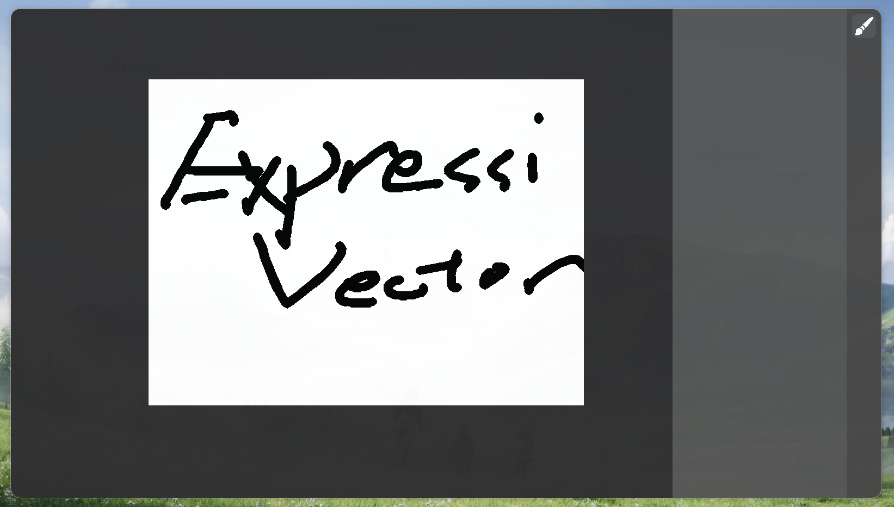
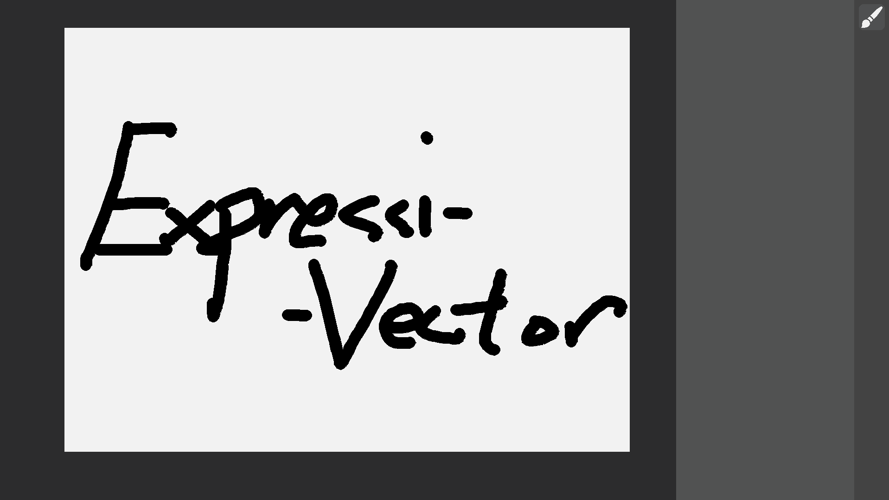

# **ExpressiVector**
**Vector image creator designed to explore the mathematical nature with precise parameter control.**

# Overview
Project ExpressiVector is a vector image creator designed to provide user precise control over the tools and mechanisms, targeting to be utilized to create high quality vector art, and accurate mathematical diagrams, while focusing on accessibility, maintainability and readability.
The project is written in python, backed by pygame (specifically, pygame-ce / pygame Community Edition). However, a remarkably amount of infrastructures are built from scratch, including the vector composing geometry math and the UI widget system.

The project includes:
- A reusable generic UI Widget System
- A Vector Image Engine
- Various infrastructure required to build the project, such as geometry abstractions and logical helpers

# Screenshot



# Installation
## Execute from source
*Make sure `python`, `pip` are installed.*

**To execute:**
1. Download the source code from github
2. `cd` into the project directory, and execute the following commands:
   ```bash
   python -m venv venv
   ./venv/bin/python -m pip install -r requirements.txt
   ./venv/bin/python main.py
   ```

## Pre-build binary
*The pre-build binary attached is targeting Arch Linux x86_64 (7.2.7-arch1-1).*
**To execute:**
1. Download and extract the release folder from github
2. Execute directly (ensure _internal directory is in current working directory):
   ```bash
   ./ev
   ```

# Control
**To begin: select a tool on the sidebar at the right.**

## Basic
- **To select tool:** click the icon on the sidebar of the respective tool
- **To pan (move camera):** drag while holding down middle mouse button
- **To zoom in/out:** scroll middle mouse button

## Stroke Tool:
- **To draw stroke:** move the cursor while holding down left mouse button

# Credit
- UI Widget System inspired by: [Qt](https://www.qt.io/)
- Dark Visual Theme inspired by: [Adobe Photoshop](https://www.adobe.com/products/photoshop.html)
- Geometry Infrastructure inspired by: [TXLib](https://www.github.com/TXWD1234/TXLib)
- Project back by: [Pygame](https://www.pygame.org/docs/)

## School Project Disclaimer
This project is indeed planned to be submitted as a school project. However, most of it's content was exceeding the requirement of the school project and was my own inspiration. Therefore, from the pursuit of showing this project to the public, as well as completing my Terra session during the time of the development of this project, the decision of submiting it to Terra was made.

*According to [@miggy](https://hackclub.enterprise.slack.com/team/U07VC9705D4)'s [response](https://hackclub.slack.com/archives/C0B7KLRAFFW/p1793396485684439), the project is valid as long as the distinction are cleanerly documented.*

The following are the features required by the school project:
- Stroke
- Shapes
- Eraser
- Stamp bitmaps
- Load/Save
- Pick Color

The following are the features implemented by my own inspiration:
- Vector Based Images
- Canvas Zooming & Canvas Panning
- Sophisticated and Reusable UI System
- Additional Tools
- Additional Parameter and Configurations
- Layering

*The project is still in development and had not achieved final completion, therefore expect the absence of some listed features.*